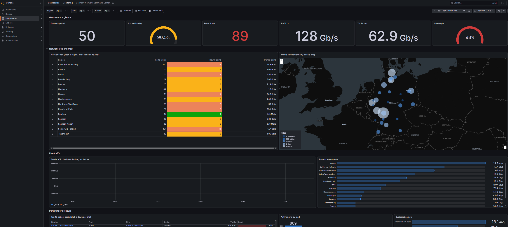
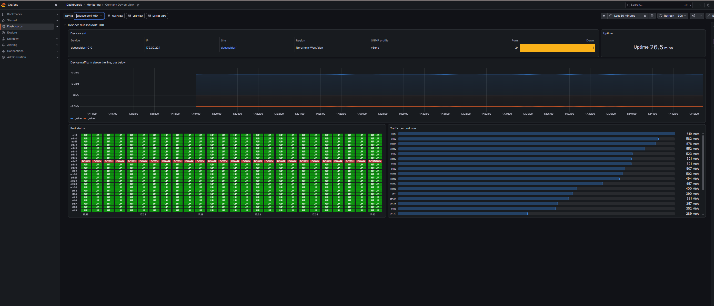

# Monitoring Prototype

A network monitoring stack with NetBox as the source of truth. Telegraf configs poll devices over SNMP, InfluxDB stores the data and Grafana shows it.

by default It runs on 50 simulated devices out of the box, but it can be easily connected to an existing NetBox instance to monitor real devices. just see [For production](#for-production).




## How to run
first clone the project:
```bash
git clone https://github.com/SadeghAllahverdi/monitoring-prototype.git
cd monitoring-prototype
```
Docker Secrets and NetBox are not in the repo so set them up first. start with cloning netbox.

```bash
git clone -b release https://github.com/netbox-community/netbox-docker.git sot/netbox-docker
```
then copy the override yaml file to the netbox folder

```bash
cp sot/netbox-override.backup.yml sot/netbox-docker/docker-compose.override.yml
```

then create these files with random values (and no newline at the end).

`sot/netbox-docker/secrets/`:
- `api_token_pepper_1.txt` and `secret_key.txt`: at least 50 characters
- `superuser_api_key.txt`: exactly 12 characters
- `superuser_api_token.txt`: exactly 40 characters
- `db_password.txt`, `redis_password.txt`, `redis_cache_password.txt`, `superuser_password.txt`

`vis/snmp-bucket/secrets/`:
- `snmp_v2_community.txt`, `snmp_v3enc_auth.txt`, `snmp_v3enc_priv.txt`, `snmp_v3noenc_auth.txt`

`vis/influxdb/secrets/`:
- `admin-username.txt` (just `admin`), `admin-password.txt`, `admin-token.txt`

`vis/grafana/secrets/`:
- `admin-password.txt`


Then run `docker compose up -d --build`.


First start takes about 5 to 10 minutes. netbox it self takes a couple of minutes to run and also the seed.py needs to create the fake device data (feel free to change the random state btw)
To stop it: `docker compose down`. Adding `-v` wipes the data.

- Grafana: http://127.0.0.1:3000/d/germany-noc (password in `vis/grafana/secrets/admin-password.txt`)
- InfluxDB: http://127.0.0.1:8086 (password in `vis/influxdb/secrets/admin-password.txt`)
- NetBox: http://127.0.0.1:8000 (password in `sot/netbox-docker/secrets/superuser_password.txt`)

here the user is `admin` everywhere.


## For production

1. Remove the simulation lines in `docker-compose.yml`.
2. Follow the note at the top of `docker-compose.override.yml`.
3. In `vis/telegraf/docker-compose.yml`, remove `snmp-lab` and set `NETBOX_URL` to the real NetBox.
4. In `vis/snmp-bucket/profiles.yaml`, remove the `context_name` lines.
5. Make 3 tokens: read-only NetBox for the generator, write-only InfluxDB for Telegraf, read-only InfluxDB for Grafana. The generator's token setup in `vis/telegraf/docker-compose.yml` has to change, because it reads lab secrets.
6. Make new strong passwords, and set the InfluxDB retention.
